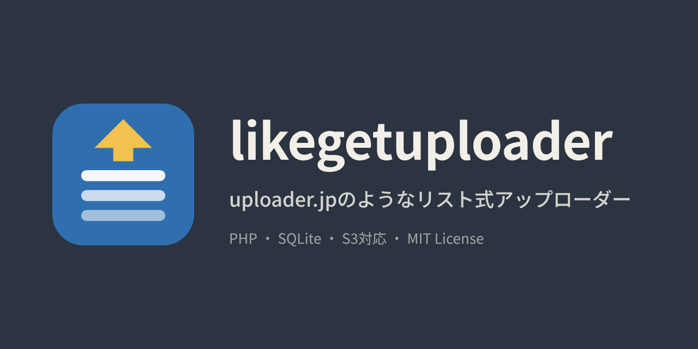
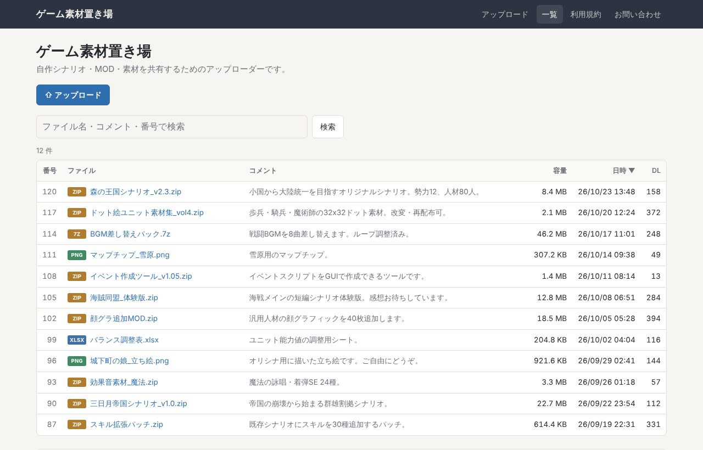
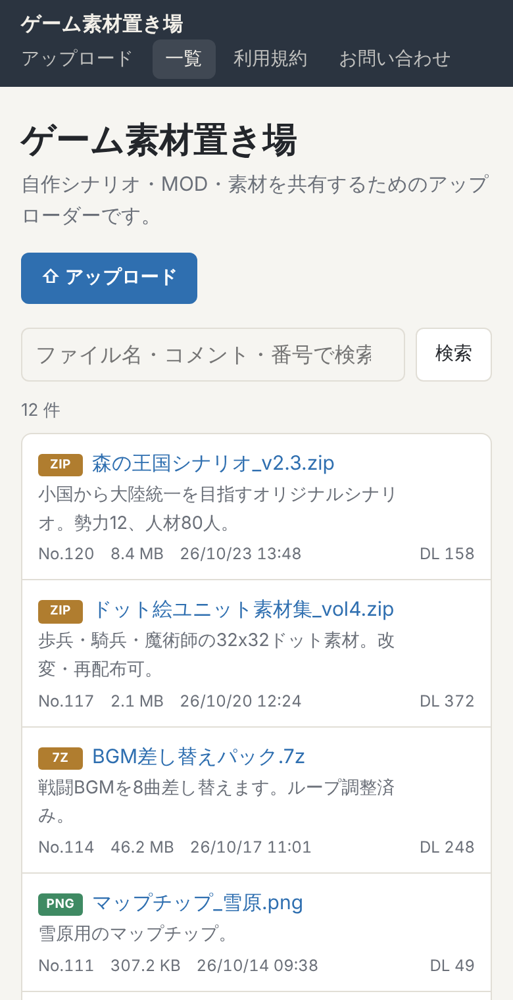

<p align="center"></p>

# likegetuploader

uploader.jp のようなリスト式アップローダー。

「ゲームのMOD・シナリオ置き場」「サークルの素材置き場」のように、**1つの目的のためのファイルを番号付きの一覧で並べる**アップローダーを、自分のサーバーに設置できます。PHP だけで動き、データベースサーバーは要りません。

> **注意**: このソフトは uploader.jp（getuploader.com）とは無関係の非公式プロジェクトです。2026年11月25日の uploader.jp のサービス終了を受けて、同じ使い勝手のアップローダーを各自で運営できるように作りました。



<p align="center"></p>

## 特徴

**uploader.jp と同じ使い勝手**
- 番号・ファイル名・コメント・容量・日時・DL数の一覧、並べ替え、検索、ページ送り
- ファイルページ経由のダウンロード（直リンク不可）、MD5表示
- 削除キー（投稿者が自分で削除）、DLパスワード、アップロードパスワード
- `/download/123` 形式のURL、統計（ディスク使用量・ファイル数・総DL数）、リンク欄
- お問い合わせフォーム、通報フォーム
- **uploader.jp からの引っ越しツール付き**（番号・日時・DL数・コメントをそのまま移行）

**運営をラクにする機能**
- 管理画面：ファイルの修正・非公開・削除、投稿者のアップロード禁止、通報・お問い合わせの確認
- **管理者へのメール通知**（SMTP。お問い合わせ・通報・新規アップロード）
- **Cloudflare Turnstile**（人間確認）をアップロード・ダウンロード・お問い合わせ・管理ログインに個別に設定
- 連続投稿の制限、二重拡張子などの危険なファイルの拒否
- IPアドレスは生で保存せず、ハッシュで保存

**サーバーにやさしい**
- **S3互換ストレージに保存可能**（Backblaze B2 / Cloudflare R2 / iDrive e2 / Wasabi など）。VPSのディスクも回線もほとんど使いません
- 8MBずつの分割アップロードなので、Cloudflare経由でも大きなファイルを送れます
- 外部ライブラリ不要（S3・SMTP・Turnstileも自前実装）

**収益化**
- 広告枠7か所＋`<head>`内タグ欄（AdSense・Googleアナリティクス・サイト認証）＋`</body>`直前タグ欄
- ads.txt を管理画面から編集

**見た目**
- スマホではカード型に切り替わるレスポンシブデザイン、ダークモード対応
- ファビコン・OGP（X/Discord等にURLを貼った時のカード表示）対応。ファイルページはファイル名とコメントがカードに出ます

## 必要なもの

- PHP 8.1 以上（拡張: pdo_sqlite, fileinfo, mbstring, curl, openssl）
- Apache（同梱の `.htaccess` を使用）または nginx（`nginx.conf.sample` を参照）

## 設置

1. このリポジトリをダウンロードしてサーバーに置く
2. `config.sample.php` を `config.php` という名前でコピーし、最低限次を変更
   - `title` / `description`（サイト名と説明）
   - `admin_password`（管理パスワード）
   - `secret`（長いランダム文字列。例: `openssl rand -hex 32` の出力）
   - Cloudflare 経由なら `behind_cloudflare => true`
3. `data/` フォルダに書き込み権限を付ける
4. ブラウザで開いて表示されればOK
5. **`https://あなたのサイト/data/uploader.sqlite` を開いて 403 になることを必ず確認**（中身が見えたらサーバー設定の誤りです）

`/download/123` 形式のURLが使えない環境では、`config.php` の `pretty_urls` を `false` にしてください。

## 設定

設定は `config.php` で行います（各項目にコメントがあります）。現在の設定は管理画面の「設定状況」で確認できます。

### S3 に保存する

`'storage' => 's3'` にして、`'s3'` 欄にエンドポイント・バケット・キーを書きます。管理画面の「設定状況」→「S3接続テスト」で確認できます。

- バケットは**非公開のままでOK**（ダウンロード時に、数分だけ有効な署名付きURLへ転送します）
- 公開バケットやCDN経由で配りたい場合は `public_url` を設定
- 途中で切り替えても既存ファイルはそのまま配信されます。サーバー上のファイルをS3へ移すには `php tools/move_to_s3.php`
- キーには、そのバケットだけの読み書き・削除権限を付けるのがおすすめです
- バケットのライフサイクル設定で「未完了のマルチパートアップロードを数日で削除」も入れておくと安心です

### Turnstile（人間確認）

Cloudflare ダッシュボード → Turnstile でサイトを追加し、サイトキーとシークレットキーを `'turnstile'` 欄に書きます。`upload` / `download` / `contact` / `admin` を個別に `true` / `false` で切り替えられます。一度確認が通った人は、一定時間（既定10分）再確認されません（管理ログインは毎回）。

### メール通知（SMTP）

`'mail'` 欄で設定します。お問い合わせ・通報・新規アップロードの通知を、それぞれ有効/無効にできます。お問い合わせの通知メールには相手のアドレスが Reply-To に入るので、そのまま返信できます。管理画面の「設定状況」→「テストメール送信」で確認できます。

### アクセス解析・AdSense

管理画面の「解析・共通タグ」に貼り付けます。

- Googleアナリティクス、AdSense（審査用コード・自動広告）、サイト認証の meta タグ → 「`<head>` 内に入れるタグ」
- ads.txt → 同じ画面の ads.txt 欄（`/ads.txt` で配信）。サブフォルダに設置した場合は、ドメイン直下に別途置いてください
- 位置を決めて出すバナー広告 → 「広告枠」タブ

| 広告枠 | 場所 |
|---|---|
| top | 全ページ上部 |
| list_top / list_middle / list_bottom | 一覧の上 / 10件目の後 / 下 |
| detail_top / detail_bottom | ファイルページの上 / ダウンロードボタンの下 |
| side | 右サイドバー（スマホでは一覧の下） |

### ファビコン・OGP

最初からサンプルのアイコンとOGP画像が入っています。自分のサイト用に変えるときは、次のファイルを同じ名前で差し替えてください。

| ファイル | 用途 | サイズ |
|---|---|---|
| `favicon.ico` | ブラウザのタブ（古いブラウザ用） | 16/32/48px |
| `assets/favicon.svg` | ブラウザのタブ | 正方形のSVG |
| `assets/apple-touch-icon.png` | スマホのホーム画面 | 180×180 |
| `assets/ogp.png` | SNSのカード画像 | 1200×630 |

OGP画像は `config.php` の `ogp_image` で別の画像やURLも指定できます。`twitter_site` にXのアカウントを書くと、カードに表示されます。

### デモモード

サンプルとして公開する場合は `'demo' => ['enabled' => true]` にすると、新しくアップロードされたファイルが一定時間（既定24時間）で自動削除され、サイズ上限も下がります。

## uploader.jp からの引っ越し

uploader.jp は **2026年11月25日 23:59 にすべてのデータが削除されます**。早めにバックアップしてください。

### 1. バックアップ（手元のPCで実行）

Python 3.8 以上があれば、追加のインストールなしで動きます。

```
python tools/getuploader_backup.py アップローダー名 ./保存先フォルダ
```

例: `https://ux.getuploader.com/vahren/` なら `python tools/getuploader_backup.py vahren ./vahren_backup`

- まず `--limit 5` で数件だけ試すのがおすすめです
- 相手のサーバーに負担をかけないよう3秒間隔で取得します（900件ほどで1時間前後）
- 止めても、同じコマンドで続きから再開できます
- 詳細ページのMD5と照合して、一致したものだけ保存します
- パスワード付きのファイルなど、取得できなかったものは `failed.jsonl` に記録されます

### 2. 取り込み（サーバーで実行）

```
php tools/import.php ./保存先フォルダ
```

番号・ファイル名・コメント（一覧で省略されていた部分も全文）・日時・DL数がそのまま入ります。新しいアップロードは最大番号の次から始まります。S3保存に設定してあれば、ファイルはS3へ送られます。

> **ファイルの権利について**: バックアップしたファイルの著作権は、それぞれの投稿者にあります。自分が管理していたアップローダーの移行や、コミュニティで合意のうえでの保全に使い、再公開する場合は投稿者の意向に配慮してください。

## バックアップ

`data/` フォルダを丸ごとコピーすればすべてです（DB・ファイル・設定テキスト）。S3保存の場合は、ファイル本体があるバケットも合わせてバックアップしてください。

## ファイル構成

```
index.php        一覧・アップロードフォーム
file.php         ファイルページ（/download/123）
dl.php           ダウンロード
upload.php       分割アップロードAPI
contact.php      お問い合わせ
admin.php        管理画面
rules.php        利用規約
adstxt.php       /ads.txt
inc/             共通処理（s3.php / mail.php / turnstile.php など）
assets/          CSS・JavaScript
data/            DB・ファイル・設定テキスト（外部から見えない）
tools/           uploader.jp バックアップ・取り込み・S3移行ツール
```

## ライセンス

[MIT License](LICENSE)
